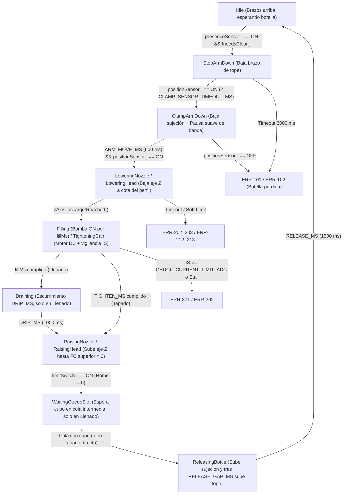

# Arquitectura de Software y Hardware: Estación 3 (Llenado y Tapado)

Este documento describe la arquitectura técnica real e implementada de la **Estación 3 (Llenado y Tapado)** para una línea de Sistemas de Manufactura Flexible (FMS), incluyendo sus estándares de codificación, patrones de diseño embebido, máquinas de estados (FSM), interfaz HMI táctil de 5 pestañas, modo de prueba manual (`TestMode`), compensación de carga $I \times R$, modelo de concurrencia cooperativa + ISR y mapeo físico de pines.

El controlador principal de la estación es un **Arduino Mega 2560 (ATmega2560, 8 bits AVR @ 16 MHz, 256 KB Flash, 8 KB SRAM, 4 KB EEPROM, lógica de 5 V)**.

---

## 0. Descripción Física y Operativa de la Estación

La estación es **lineal**: una banda transportadora unidireccional traslada las botellas a través de dos estaciones de proceso dispuestas en serie (**Autómata 1: Llenado** y **Autómata 2: Tapado**).

| Subsistema | Descripción y Componentes Reales |
| :---- | :---- |
| **Banda transportadora** | Motor DC controlado por puente H **BTS7960 (IBT-2)** unidireccional (`RPWM` en Pin 10, `EN` en Pin 12) con rampa trapezoidal suave, **sensado analógico de corriente `IS` (`A8`)**, compensación opcional de caída de tensión bajo carga ($I \times R$) y protección contra atasco (`ERR-303`). |
| **Autómata 1: Llenado** | **2 sensores ópticos IR** (sensor de *aproximación/presencia* en Pin 15 y sensor de *posición exacta* en Pin 16, ubicados antes y en medio de los brazos); **2 servomotores** con sentido `CW`/`CCW` configurable (*brazo de tope* en Pin 47 y *brazo de sujeción* en Pin 49); **bomba de agua ON/OFF** (Pin 45) con temporizador de seguridad; **eje vertical a pasos Z1** (`STEP` Pin 37, `DIR` Pin 35, `EN` Pin 33) con fin de carrera superior de origen (`HOME = 0` en Pin 23). |
| **Autómata 2: Tapado** | **2 sensores ópticos IR** (*aproximación/presencia* en Pin 17 y *posición exacta* en Pin 18); **2 servomotores** (*brazo de tope* en Pin 51 y *brazo de sujeción* en Pin 53); **motor DC de apriete** con puente H **BTS7960** (`RPWM` Pin 11, `EN` Pin 32) y **sensado de corriente `IS` (`A9`)** para detección de sobrecorriente (`ERR-301`) y rosca trasroscada (`ERR-302`); **eje vertical a pasos Z2** (`STEP` Pin 31, `DIR` Pin 29, `EN` Pin 27) con fin de carrera superior (`HOME = 0` en Pin 25). |
| **Botonera y Señalización** | Pulsadores físicos de **START** (Pin 46), **STOP** (Pin 48), **RESET** (Pin 52) y contacto auxiliar de **E-STOP** (Pin 50). Torreta luminosa **Verde** (Pin 41) y **Roja** (Pin 43) más alarma acústica no bloqueante **Buzzer** (Pin 39). |
| **HMI Táctil Local** | Pantalla **TFT 2.4" ILI9341 (320×240 px, bus paralelo de 8 bits)** con panel táctil resistivo de 4 hilos y navegación inferior de **5 pestañas** (`Home`, `AutoFill`, `AutoCap`, `Debug`, `Settings`). |
| **Flexibilidad** | Admite **dos perfiles de botella (`Small` y `Large`)** seleccionables desde la pantalla táctil, ajustando las cotas verticales `fillZSteps`, `capZSteps` y el tiempo de dosificación `fillMs`. Además permite habilitar o deshabilitar el módulo de tapado (`ENABLE_CAPPING_STATION`) y la cola intermedia (`ENABLE_INTERSTAGE_QUEUE`). |

### Secuencia Coordinada de Sensores, Brazos y Banda (Idéntica en Ambos Autómatas)

1. **Detección de aproximación (`Idle` $\rightarrow$ `StopArmDown`):** Al activarse el **1er sensor óptico (`presenceSensor_`)**, el autómata baja inmediatamente el **brazo de tope** (el del extremo de salida de la zona) mientras la banda sigue avanzando para llevar la botella hasta el tope.
2. **Confirmación en posición y sujeción con pausa suave de banda (`StopArmDown` $\rightarrow$ `ClampArmDown`):** Cuando la botella llega al tope y activa el **2do sensor óptico (`positionSensor_`, situado entre ambos brazos)** antes de `CLAMP_SENSOR_TIMEOUT_MS` (3000 ms), baja el **brazo de sujeción**. Durante los `ARM_MOVE_MS` (600 ms) que tarda en cerrarse el brazo de sujeción, `StationController` **pausa suavemente la banda (`pauseSmooth()`)** para centrar y sujetar el envase con firmeza.
3. **Reanudación de banda y ejecución del proceso (`Lowering` $\rightarrow$ Proceso $\rightarrow$ `Raising`):** Una vez cerrados ambos brazos y revalidado `positionSensor_`, la banda vuelve a girar (permitiendo que botellas en el otro autómata sigan avanzando) mientras el eje Z baja a la cota del perfil, ejecuta el llenado o el apriete de tapa, y regresa hasta accionar su fin de carrera superior (`HOME = 0`).
4. **Liberación escalonada (`ReleasingBottle`):** Se levanta primero el brazo de sujeción y, tras `RELEASE_GAP_MS` (500 ms), se levanta el brazo de tope. La bandera `needsClear_` impide re-disparar un nuevo ciclo hasta que la botella saliente libere por completo ambos sensores ópticos (`!presenceSensor_ && !positionSensor_`).

---

## 1. Reglas de Idioma, Estilo y Nomenclatura

### 1.1 Políticas de Idioma
* **Identificadores del código (Inglés técnico obligatorio):** Clases, métodos, funciones, variables, estructuras, enumeraciones y constantes se declaran exclusivamente en inglés.
* **Comentarios y Documentación (Español técnico):** Los bloques Doxygen en encabezados `.hpp` y los comentarios explicativos en `.cpp` se redactan en español.
* **Textos de Interfaz HMI (Español):** Todos los textos proyectados en la pantalla TFT 2.4" se almacenan en memoria Flash (`PROGMEM` / `F()`) en español.

### 1.2 Formato de Llaves (Allman Style)
El proyecto utiliza estrictamente el estilo **Allman** en todos sus archivos `.hpp` y `.cpp`:
```cpp
if (positionSensor_.isTriggered())
{
    nextState_ = FillState::ClampArmDown;
}
else if (elapsedMs >= ProcessParams::CLAMP_SENSOR_TIMEOUT_MS)
{
    triggerFault(ErrorCode::FillBottleLost);
}
```

### 1.3 Convenciones de Nomenclatura

| Elemento | Convención | Ejemplo |
| :---- | :---- | :---- |
| **Clases / Structs** | `PascalCase` | `StepperAxis`, `DisplayManager`, `StationController` |
| **Métodos y Funciones** | `camelCase` | `moveToTarget()`, `sampleCurrentAdc()`, `update()` |
| **Variables locales y parámetros** | `camelCase` | `targetSteps`, `elapsedMs` |
| **Miembros privados de clase** | `camelCase` con sufijo `_` | `currentState_`, `filteredAdc_`, `testFlags_` |
| **Constantes de configuración** | `UPPER_SNAKE_CASE` | `BELT_TARGET_MV`, `Z_CRUISE_SPEED`, `OPTICAL_ACTIVE_HIGH` |
| **Valores de `enum class`** | `PascalCase` | `StationMode::TestMode`, `ServoDir::CCW` |
| **Nombres de Archivos** | `snake_case` | `conveyor_controller.hpp`, `display_manager.cpp` |

### 1.4 Separación Estricta de Configuración (`include/config/`)
Toda constante física o de calibración reside exclusivamente en uno de dos archivos:
* **[`include/config/hardware_pins.hpp`](file:///home/think/@ut/SMF-E3/include/config/hardware_pins.hpp):** Define **únicamente el mapeo eléctrico de pines GPIO y canales ADC** del Arduino Mega 2560.
* **[`include/config/process_params.hpp`](file:///home/think/@ut/SMF-E3/include/config/process_params.hpp):** Centraliza **todos los parámetros de proceso y calibración**: polaridad de sensores ópticos, habilitación de módulos, velocidades y cotas de ejes Z, tensiones y compensación $I \times R$ de la banda, sentidos `CW`/`CCW` y ángulos de cada servomotor, tiempos de bombeo y apriete, umbrales ADC de corriente, calibración táctil y tabla `BOTTLE_PROFILES`.

---

## 2. Arquitectura de Concurrencia y Asignación de Timers

### 2.1 Super-Loop Cooperativo de Tres Tareas + ISR en Tiempo Real Duro

El firmware evita el uso de RTOS para preservar los 8 KB de SRAM (~22.4 % de uso estático actual) y divide el procesamiento en dos niveles:

```text
                ┌──────────────────────────────────────────┐
                │      ATmega2560 @ 16 MHz (1 núcleo)      │
                └──────────────────────────────────────────┘
                                     │
          ┌──────────────────────────┴──────────────────────────┐
          ▼                                                     ▼
   ┌──────────────────┐                               ┌───────────────────┐
   │  INTERRUPCIONES  │                               │    SUPER-LOOP     │
   │ (Tiempo Real HW) │                               │   (Cooperativo)   │
   └────────┬─────────┘                               └─────────┬─────────┘
            │                                                   │
            ├─ Timer3 COMPB @ 20 kHz: Emisión de pulsos STEP    ├─ cada 1 ms  : StationController::update()
            │   en PORTC (Z1 + Z2), lectura directa de PINA     │   (Sensores, E-STOP, Botonera, Autómatas
            │   (fines de carrera) y vigilancia de Soft Limits. │    FSM, Torreta y Buzzer)
            │                                                   │
            ├─ Timer4 OVF/COMPB/C @ 976 Hz: PWM asistido para   ├─ cada 20 ms : StationController::updateMotionProfiles()
            │   pines cuyo Timer5 está reservado por Servo.     │   (Rampas trapezoidales Z1/Z2, rampa de
            │                                                   │    banda, lectura ADC IS y boost I*R)
            └─ Timer0: Base de tiempo millis() / micros()       │
                                                                └─ cada 50 ms : DisplayManager::pollTouchCommand()
                                                                    y DisplayManager::render() incremental
```

### 2.2 Mapa de Timers de Hardware del ATmega2560

| Timer | Uso en el Proyecto | Pines / Registros Asociados |
| :---- | :---- | :---- |
| **Timer0** (8 bits) | `millis()`, `micros()`, `delayMicroseconds()` del core Arduino. | Pin 4 ocupado por `LCD_D4` de la TFT. |
| **Timer1** (16 bits) | PWM por hardware (`490 Hz`) para el motor DC del cabezal de apriete (`PIN_BTS_CHUCK_RPWM = 11`). | `OC1A` (Pin 11). Pin 12 se usa como GPIO (`PIN_BTS_CONV_EN`). |
| **Timer2** (8 bits) | PWM por hardware (`490 Hz`) para el motor DC de la banda transportadora (`PIN_BTS_CONV_RPWM = 10`). | `OC2A` (Pin 10). Pin 9 ocupado por `LCD_D1`. |
| **Timer3** (16 bits) | **ISR de pasos `TIMER3_COMPB_vect` a 20 kHz** (`OCR3A = 99`, `OCR3B = 99`, prescaler 8). Se usa `COMPB` porque la librería `Servo` enlaza `TIMER3_COMPA_vect`. | Emite pulsos en `PORTC` (Pines 37 y 31) y lee `PINA` (Pines 23 y 25). |
| **Timer4** (16 bits) | Canal PWM auxiliar a ~976 Hz en [`DcMotorBts7960`](file:///home/think/@ut/SMF-E3/lib/DcMotorBts7960/dc_motor_bts7960.cpp) por si un puente H se asigna a los pines 44–46. | Pines 6, 7 y 8 usados por la pantalla TFT / Touch. |
| **Timer5** (16 bits) | Gobernado por la librería estándar `Servo` para generar los pulsos de los 4 servomotores. | Servos en Pines 47, 49, 51 y 53. |

---

## 3. Módulos de Abstracción de Hardware (HAL) en `lib/`

1. **[`DigitalSensor`](file:///home/think/@ut/SMF-E3/lib/DigitalSensor/digital_sensor.hpp):**
   * Filtro antirrebote no bloqueante basado en `millis()` (`SENSOR_DEBOUNCE_MS = 25 ms`), con polaridad (`activeHigh`) y resistencia `INPUT_PULLUP` configurables.
   * Detecta nivel estable (`isTriggered()`) y flancos de subida/bajada (`onRisingEdge()`, `onFallingEdge()`).

2. **[`DcMotorBts7960`](file:///home/think/@ut/SMF-E3/lib/DcMotorBts7960/dc_motor_bts7960.hpp):**
   * Controla drivers de puente H **BTS7960 (IBT-2)** en configuración unidireccional (`RPWM` + `EN`, con `LPWM` a GND) o bidireccional.
   * **Muestreo ADC sincronizado con PWM (`sampleCurrentAdc()`):** En el BTS7960, el espejo de corriente `IS` ($k_{\text{ILIS}} \approx 8500$, ~`24 cuentas ADC/A` sobre la resistencia de $1\text{ k}\Omega$ en placa) solo entrega señal mientras el MOSFET de rama alta conduce (pulso PWM en `HIGH`). Para evitar leer `0` a ciclos de trabajo bajos, `sampleCurrentAdc()` inspecciona directamente el registro de entrada del puerto (`*portInputRegister(port) & bitMask`) esperando el flanco `HIGH` y 15 µs de asentamiento antes de ejecutar `analogRead()`, **sin invocar jamás `digitalRead()`** (ya que en el core AVR de Arduino `digitalRead()` sobre un pin PWM ejecuta `turnOffPWM()` y apaga la salida PWM).
   * Aplica media móvil de 8 muestras con redondeo superior para preservar lecturas de baja corriente.

3. **[`ConveyorController`](file:///home/think/@ut/SMF-E3/lib/ConveyorController/conveyor_controller.hpp):**
   * Gestiona la rampa trapezoidal de aceleración (`BELT_ACCEL_PWM_STEP`) y desaceleración (`BELT_DECEL_PWM_STEP`) cada 20 ms, permitiendo pausas suaves (`pauseSmooth()`) al sujetar botellas y paradas inmediatas (`stop()`, `brake()`).
   * **Compensación lineal de carga $I \times R$ (`ENABLE_BELT_IR_COMP`):** Ajusta automáticamente la tensión efectiva del motor entre `BELT_TARGET_MV` (en vacío, $\le$ `BELT_IDLE_CURRENT_ADC`) y `BELT_MAX_BOOST_MV` (a plena carga, $\ge$ `BELT_FULL_LOAD_ADC`).
   * **Vigilancia de atasco (`ENABLE_BELT_STALL_PROT`):** Declara fallo `ERR-303` si la corriente filtrada iguala o supera `BELT_CURRENT_LIMIT_ADC` de forma continua durante `BELT_STALL_MS`.

4. **[`StepperAxis`](file:///home/think/@ut/SMF-E3/lib/StepperAxis/stepper_axis.hpp):**
   * Gobierna los drivers de motor a pasos (TB6600) de los ejes verticales `FillZ` (Z1) y `CapZ` (Z2).
   * Genera pulsos `STEP` a 20 kHz desde la ISR del Timer3 y calcula la rampa trapezoidal de velocidad cada 20 ms en `updateMotionProfile()`.
   * **Seguridad en tiempo real duro dentro de la ISR:**
     * Al subir (`!dirDown_`), lee directamente `PINA` en cada tick de 50 µs; en cuanto se activa el fin de carrera superior (`limitSwitchActiveLow`), detiene el motor en el acto y fija `currentSteps_ = 0` (`HOME = 0`).
     * En secuencia `home()`, tras tocar el fin de carrera retrocede `Z_HOME_BACKOFF_STEPS` hacia abajo y establece el cero definitivo.
     * Al bajar (`dirDown_`), evalúa `currentSteps_ >= maxTravelSteps_` en la propia ISR, deteniendo el eje inmediatamente y activando `softLimitTripped_` (`ERR-202` / `ERR-212`).
   * Incluye movimientos manuales seguros `jogUp()` (reinicia el contador a `0` al tocar el fin de carrera) y `jogDown()` (acotado por `maxTravelSteps_`).

5. **[`BottleGate`](file:///home/think/@ut/SMF-E3/lib/BottleGate/bottle_gate.hpp):**
   * Administra el par de servomotores de cada estación (*brazo de tope* y *brazo de sujeción*).
   * Soporta inversión de giro mecánico por servomotor mediante `ServoDir::CW` (ángulo directo `0°..180°`) o `ServoDir::CCW` (`180° - ángulo`).
   * Ofrece accionamiento individual (`lowerStopArm()`, `raiseStopArm()`, `lowerClampArm()`, `raiseClampArm()`), levantamiento inmediato (`raiseArmsImmediate()`) y secuencia no bloqueante de liberación escalonada (`releaseBottle()`).

6. **[`FillPump`](file:///home/think/@ut/SMF-E3/lib/FillPump/fill_pump.hpp):**
   * Controla la bomba de dosificación con corte autónomo de seguridad al alcanzar `MAX_PUMP_ON_MS` (8000 ms), independientemente del estado de la FSM.

7. **[`AlarmBuzzer`](file:///home/think/@ut/SMF-E3/lib/AlarmBuzzer/alarm_buzzer.hpp):**
   * Generador no bloqueante de patrones acústicos (`Silent`, `BootReady`, `Warning`, `Fault`, `EmergencyStop`) mediante `millis()`, evitando el uso de `tone()` para no interferir con el Timer2 (PWM de la banda en Pin 10).

8. **[`DisplayManager`](file:///home/think/@ut/SMF-E3/lib/DisplayManager/display_manager.hpp):**
   * Controlador gráfico para el shield TFT 2.4" ILI9341 (`MCUFRIEND_kbv`) y su panel táctil resistivo (`TouchScreen` + `Adafruit_GFX_Button`).
   * Restaura inmediatamente la dirección `OUTPUT` y el estado `HIGH` de los pines compartidos (`XM = A2/LCD_RS`, `YP = A1/LCD_WR`, `XP = 6`, `YM = 7`) tras cada lectura táctil en `restoreSharedTftPins()`.
   * Implementa **filtro de retención táctil (`TOUCH_RELEASE_TICKS = 3`) y *cooldown* antirrebote (`TOUCH_COOLDOWN_MS = 220 ms`)** para impedir dobles pulsaciones por ruido eléctrico al conmutar motores o relés.

---

## 4. Máquinas de Estados (FSM) y Modos de Operación

### 4.1 Modos Globales en `StationController` (`StationMode`)

| Modo (`StationMode`) | Comportamiento y Transiciones |
| :---- | :---- |
| **`Boot`** | Estado inicial al energizar (si `E-STOP` no está activo). Levanta los 4 brazos, apaga bomba/banda/cabezal y ejecuta el *homing* simultáneo de `FillZ` (y `CapZ` si `ENABLE_CAPPING_STATION = true`). Al llegar ambos ejes a `Home`, activa torreta verde, emite 2 pitidos (`BootReady`) y pasa a `Running`. Si excede `Z_HOMING_TIMEOUT_MS` (18500 ms), salta a `ErrorStop` (`ERR-201` / `ERR-211`). |
| **`Running`** | Operación automática en línea. Mantiene la banda en marcha continua (pausándola suavemente con `pauseSmooth()` únicamente durante los 600 ms de `ClampArmDown` en cualquiera de los autómatas) y ejecuta en paralelo `FillingAutomaton` y `CappingAutomaton`. Cualquier fallo transiciona toda la estación a `ErrorStop`. |
| **`ErrorStop`** | Parada segura inmediata: apaga la bomba, detiene el motor de apriete, aplica freno dinámico a la banda (`conveyor_.brake()`), detiene y deshabilita los drivers de ambos ejes Z (`EN` inactivo), enciende la luz roja de la torreta y activa el patrón acústico de alarma. Al liberar `E-STOP` y presionar `RECONOCER ALARMA` en pantalla (o el botón físico `RESET`), pasa a `ManualRecovery`. |
| **`ManualRecovery`** | Silencia el buzzer y muestra la pantalla `Settings` con los 4 botones de despeje asistido (`SUBIR Z LLENADO`, `SUBIR Z TAPADO`, `SOLTAR BRAZOS`, `LINEA DESPEJADA`). Al confirmar `LINEA DESPEJADA` (o presionar el botón físico `START`), reinicia `Boot`. |
| **`TestMode`** | **Modo de prueba manual y calibración en banco/planta.** Se activa/desactiva desde el checkbox **`TEST MODE`** en la pestaña `Settings` (permitiendo operar incluso sin la botonera física conectada). Detiene las FSM automáticas, habilita los drivers de los ejes Z y transforma las pantallas `Home`, `AutoFill` y `AutoCap` en paneles de control manual individual para cada actuador, mientras `Debug` muestra en tiempo real las entradas digitales, pasos Z y corriente/voltaje de banda. |

### 4.2 Flujo de Estados de `FillingAutomaton` y `CappingAutomaton`

Ambos autómatas implementan el patrón **FSM de 3 fases (`onEntry`, `onDuring`, `onExit`)**:



---

## 5. Interfaz HMI de 5 Pestañas (`DisplayManager`)

La pantalla TFT 320×240 mantiene fija una barra de navegación inferior (`Y = 190..239`) con 5 pestañas e iconos `48×48` en `PROGMEM` ([`lib/DisplayManager/ui_icons.hpp`](file:///home/think/@ut/SMF-E3/lib/DisplayManager/ui_icons.hpp)). Al cambiar de pestaña, solo se redibujan los 2 iconos de navegación que cambiaron de color (`drawSingleNavTab`) y el área de contenido necesaria:

1. **Pestaña 1 — `Home` (Pantalla Principal):**
   * **Modo Normal:** Muestra el banner superior de modo global, contador de botellas producidas (`PROD`), cola intermedia (`COLA`), estado resumido de `LLENADO` y `TAPADO`, y recuadro inferior de alarma (que se convierte en el botón táctil **`RECONOCER ALARMA`** cuando la estación está en `ErrorStop`).
   * **En `TestMode`:** Muestra una cuadrícula de 4 botones manuales: **`BANDA: ON/OFF`**, **`BUZZER: ON/OFF`**, **`LUZ VERDE: ON/OFF`** y **`LUZ ROJA: ON/OFF`**.

2. **Pestaña 2 — `AutoFill` (Autómata 1: Llenado):**
   * **Modo Normal:** Muestra el estado actual del proceso de llenado y dosificación.
   * **En `TestMode`:** Muestra en el encabezado la posición en vivo **`Z1: xxxx`** (con indicador `H` cuando pisa el fin de carrera) y 5 botones táctiles: **`TOPE 1: ARRIBA/ABAJO`**, **`SUJEC 1: ARRIBA/ABAJO`**, **`BOMBA LLENADO: ENCENDIDA/APAGADA`**, **`SUBIR Z1 (+JOG)`** y **`BAJAR Z1 (-JOG)`**.

3. **Pestaña 3 — `AutoCap` (Autómata 2: Tapado):**
   * **Modo Normal:** Muestra el estado actual del proceso de tapado y apriete.
   * **En `TestMode`:** Muestra en el encabezado la posición en vivo **`Z2: xxxx`** y 5 botones táctiles: **`TOPE 2: ARRIBA/ABAJO`**, **`SUJEC 2: ARRIBA/ABAJO`**, **`MOTOR APRIETE: ENCENDIDO/APAGADO`**, **`SUBIR Z2 (+JOG)`** y **`BAJAR Z2 (-JOG)`**.

4. **Pestaña 4 — `Debug` (Diagnóstico y Telemetría I/O en Tiempo Real):**
   * **Tarjeta 1 (Sensores Ópticos y Limit Switches):** Muestra el estado en vivo `[ON ]` / `[OFF]` de `PRE1` (Pin 15), `POS1` (Pin 16), `FC-Z1` (Pin 23), `PRE2` (Pin 17), `POS2` (Pin 18) y `FC-Z2` (Pin 25).
   * **Tarjeta 2 (Botonera Física y E-STOP):** Muestra el estado en vivo `[ON ]` / `[OFF]` de `STRT` (Pin 46), `STOP` (Pin 48), `RST` (Pin 52) y `ESTOP` (Pin 50, resaltado en rojo al activarse).
   * **Tarjeta 3 (Posición Ejes Z):** Cuenta de micropasos en tiempo real de `Z1 (LLENADO)` y `Z2 (TAPADO)` desde `0`, mostrando `[HOME=0]` en verde cuando el eje toca su fin de carrera superior.
   * **Tarjeta 4 (Banda y Alarma):** Muestra la tensión efectiva enviada al motor (`V`), el ciclo `PWM` (`0..255`), la lectura del espejo de corriente `IS` en `A8` (`ADC`) y el código de alarma activa.

5. **Pestaña 5 — `Settings` (Configuración, Modo Test y Recuperación Manual):**
   * **Checkbox `TEST MODE` (`48×48 px`):** Activa o desactiva `StationMode::TestMode` en cualquier momento.
   * **Selector de Perfil (`PEQUENA` / `GRANDE`):** Botón `CAMBIAR PERFIL` habilitado cuando ambos autómatas están en reposo.
   * **Botonera de Recuperación Manual:** Botones `SUBIR Z LLENADO`, `SUBIR Z TAPADO`, `SOLTAR BRAZOS` y `LINEA DESPEJADA` (activos en `ManualRecovery`).

---

## 6. Mapeo Oficial de Pines (`include/config/hardware_pins.hpp`)

| Categoría | Constante en `HardwarePins` | Pin Mega 2560 | Descripción y Notas Eléctricas |
| :---- | :---- | :---- | :---- |
| **TFT 2.4" + Touch** | `PIN_TFT_RD`, `WR`, `RS`, `CS`, `RST` | `A0` – `A4` | Bus de control TFT (`D2`–`D9` = bus paralelo de datos de 8 bits). |
| **Panel Táctil** | `PIN_TOUCH_XP`, `XM`, `YP`, `YM` | `6`, `A2`, `A1`, `7` | Líneas resistivas compartidas con el bus TFT (`restoreSharedTftPins()`). |
| **Banda (BTS7960)** | `PIN_BTS_CONV_RPWM` | `10` | Salida PWM Timer2 (`OC2A`, 490 Hz). `LPWM` cableado a GND. |
| **Banda (BTS7960)** | `PIN_BTS_CONV_EN` | `12` | Habilitación del puente H de la banda (`R_EN` + `L_EN`). |
| **Banda (Corriente)** | `PIN_ADC_CONV_CURRENT` | `A8` | Entrada analógica conectada a `R_IS` del BTS7960 (~24 cuentas ADC/A). |
| **Apriete (BTS7960)** | `PIN_BTS_CHUCK_RPWM` | `11` | Salida PWM Timer1 (`OC1A`, 490 Hz) para el cabezal de tapado. |
| **Apriete (BTS7960)** | `PIN_BTS_CHUCK_EN` | `32` | Habilitación del puente H del cabezal de apriete. |
| **Apriete (Corriente)** | `PIN_ADC_CHUCK_CURRENT` | `A9` | Entrada analógica conectada a `R_IS` del BTS7960 de apriete. |
| **Sensores Llenado** | `PIN_PRESENCE_FILL`, `PIN_POS_FILL` | `15`, `16` | Sensores ópticos de aproximación (15) y posición exacta (16) en Llenado. |
| **Sensores Tapado** | `PIN_PRESENCE_CAP`, `PIN_POS_CAP` | `17`, `18` | Sensores ópticos de aproximación (17) y posición exacta (18) en Tapado. |
| **Fines de Carrera Z** | `PIN_LIMIT_SWITCH_FILL`, `CAP` | `23` (`PA1`), `25` (`PA3`) | Fines de carrera superiores (`INPUT_PULLUP`, leídos en `PINA` desde ISR). |
| **Stepper Z2 (Tapado)** | `EN`, `DIR`, `STEP` | `27`, `29`, `31` (`PC6`) | Driver TB6600 del eje Z de tapado (`STEP` emitido por `PORTC` en ISR). |
| **Stepper Z1 (Llenado)** | `EN`, `DIR`, `STEP` | `33`, `35`, `37` (`PC0`) | Driver TB6600 del eje Z de llenado (`STEP` emitido por `PORTC` en ISR). |
| **Señalización** | `PIN_BUZZER`, `TOWER_GREEN`, `RED` | `39`, `41`, `43` | Alarma sonora (39), Torreta Verde (41) y Torreta Roja (43). |
| **Bomba de Agua** | `PIN_PUMP_FILL` | `45` | Salida de activación de la bomba de dosificación. |
| **Botonera Física** | `START`, `STOP`, `ESTOP`, `RESET` | `46`, `48`, `50`, `52` | Entradas con `INPUT_PULLUP` de marcha, paro, emergencia y rearme. |
| **Servos Llenado** | `PIN_SERVO_FILL_STOP`, `CLAMP` | `47`, `49` | Servomotores de brazo de tope (47) y sujeción (49) en Llenado. |
| **Servos Tapado** | `PIN_SERVO_CAP_STOP`, `CLAMP` | `51`, `53` | Servomotores de brazo de tope (51) y sujeción (53) en Tapado. |

---

## 7. Guía Rápida de Calibración en Planta (`include/config/process_params.hpp`)

Con el **`TEST MODE`** integrado en la pantalla `Settings` y la telemetría en vivo en `Debug`, la puesta a punto de la estación sigue 4 pasos directos:

1. **Verificar Entradas (`Debug`):**
   * Pasar una botella frente a los 4 sensores ópticos (`PRE1`, `POS1`, `PRE2`, `POS2`) y pulsar los fines de carrera (`FC-Z1`, `FC-Z2`) verificando que pasen de `[OFF]` a `[ON ]`. Si la polaridad de los sensores ópticos cambia según el modelo (NPN vs PNP), ajustar `OPTICAL_ACTIVE_HIGH` en `process_params.hpp`.
2. **Ajustar Sentido y Ángulos de Servomotores (`Auto 1` / `Auto 2` en `TestMode`):**
   * Probar `TOPE 1`, `SUJEC 1`, `TOPE 2` y `SUJEC 2`. Si un brazo gira en sentido opuesto por su montaje mecánico, cambiar su constante `FILL_STOP_DIR`, `FILL_CLAMP_DIR`, `CAP_STOP_DIR` o `CAP_CLAMP_DIR` entre `ServoDir::CW` y `ServoDir::CCW`.
3. **Medir Cotas de los Ejes Z1 y Z2 (`Auto 1` / `Auto 2` y `Debug` en `TestMode`):**
   * Subir cada eje con `+JOG` hasta tocar su fin de carrera superior (`[HOME=0]`, donde el contador de pasos se pone en `0`).
   * Bajar con `-JOG` (`Z_JOG_STEPS` por toque) hasta la altura exacta de la botella pequeña y grande, leer los pasos acumulados en pantalla y anotarlos en `BOTTLE_PROFILES[]` (`fillZSteps` y `capZSteps`).
4. **Calibrar Velocidad y Corriente de la Banda (`Home` y `Debug` en `TestMode`):**
   * Encender la banda en vacío y observar `IS: xxxx ADC` en `Debug` para fijar `BELT_IDLE_CURRENT_ADC`.
   * Colocar la carga máxima (botellas llenas retenidas en los topes), observar la lectura `IS` y anotarla en `BELT_FULL_LOAD_ADC`, activando `ENABLE_BELT_IR_COMP = true` si se desea compensación automática de tensión entre `BELT_TARGET_MV` y `BELT_MAX_BOOST_MV`.

---

## 8. Estructura Actual del Proyecto

```text
SMF-E3/
├── platformio.ini                   # Configuración de entorno megaatmega2560 y librerías fijas
├── ARCHITECTURE.md                  # Documentación técnica integral de la estación
├── include/
│   ├── config/
│   │   ├── hardware_pins.hpp        # Mapeo centralizado de pines GPIO y ADC
│   │   └── process_params.hpp       # Parámetros cinemáticos, temporales, eléctricos y perfiles
│   └── types/
│       └── station_types.hpp        # Enums (ErrorCode, StationMode, TouchCommand), flags y snapshots
├── lib/
│   ├── AlarmBuzzer/                 # HAL: Patrones acústicos no bloqueantes por millis()
│   ├── BottleGate/                  # HAL: Control de pares de servomotores con dirección CW/CCW
│   ├── ConveyorController/          # HAL: Rampa trapezoidal de banda, compensación I*R y atasco IS
│   ├── DcMotorBts7960/              # HAL: Puente H BTS7960 con muestreo ADC sincronizado al PWM
│   ├── DigitalSensor/               # HAL: Entradas discretas con antirrebote y detección de flancos
│   ├── DisplayManager/              # HMI: TFT 2.4" ILI9341 (5 pestañas Lopaka, iconos PROGMEM y Touch)
│   ├── FillPump/                    # HAL: Bomba de dosificación con corte de seguridad MAX_PUMP_ON_MS
│   └── StepperAxis/                 # HAL: Ejes Z paso a paso por ISR en Timer3 COMPB @ 20 kHz
└── src/
    ├── station/
    │   ├── station_controller.hpp   # Mediador central (Modos, TestMode, Banda, Cola, I/O y Snapshots)
    │   ├── station_controller.cpp
    │   ├── filling_automaton.hpp    # FSM de 3 fases del Autómata 1 (Llenado)
    │   ├── filling_automaton.cpp
    │   ├── capping_automaton.hpp    # FSM de 3 fases del Autómata 2 (Tapado)
    │   └── capping_automaton.cpp
    └── main.cpp                     # Punto de entrada y planificador cooperativo (1 ms / 20 ms / 50 ms)
```
