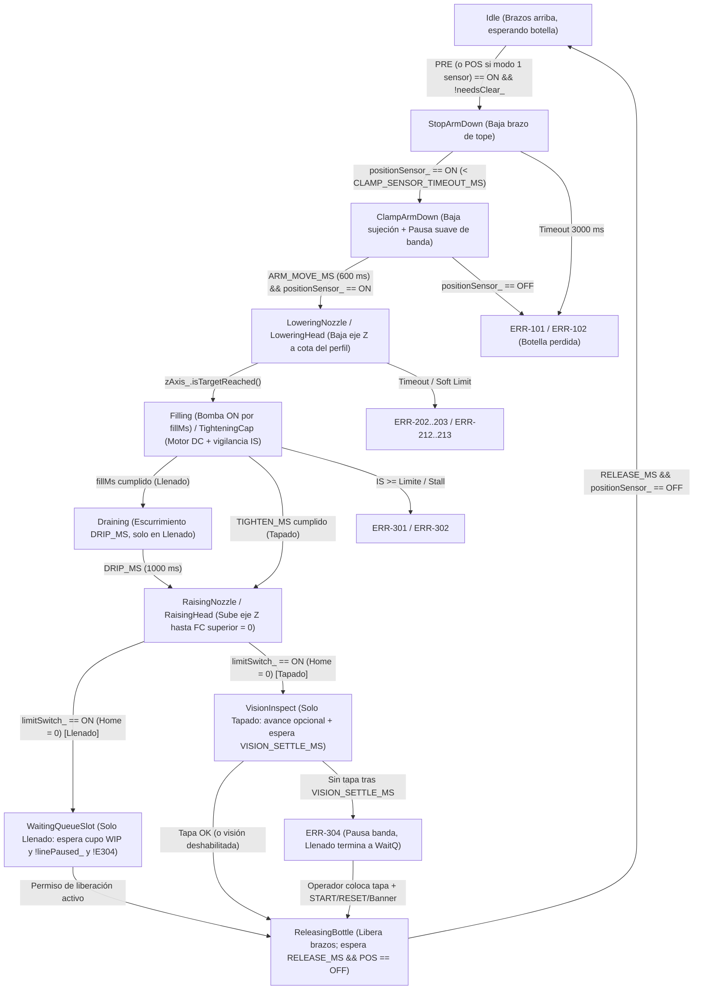

# SMF-E3 — Estación 3 (Llenado y Tapado)

Este documento describe la arquitectura técnica real e implementada de la **Estación 3 (Llenado y Tapado)** para una línea de Sistemas de Manufactura Flexible (FMS), incluyendo sus estándares de codificación, patrones de diseño embebido, máquinas de estados (FSM), inspección por visión artificial (`ESP32 + MATLAB`), interfaz HMI táctil de 5 pestañas con ajustes paginados en tiempo real (`AJUSTES 1/3..3/3`), pantalla de recuperación bloqueada (`ManualRecovery`), modo de prueba manual (`TestMode`), compensación de carga $I \times R$, modelo de concurrencia cooperativa + ISR, mapeo físico de pines y activos SVG para Figma.

El controlador principal de la estación es un **Arduino Mega 2560 (ATmega2560, 8 bits AVR @ 16 MHz, 256 KB Flash, 8 KB SRAM, 4 KB EEPROM, lógica de 5 V)**.

## Compilación y Carga (PlatformIO)

```bash
# Compilar el firmware
pio run -e megaatmega2560

# Compilar y cargar al Arduino Mega 2560
pio run -e megaatmega2560 -t upload

# Abrir monitor serie (115200 baudios)
pio device monitor -b 115200
```

---

## 0. Descripción Física y Operativa de la Estación

La estación es **lineal**: una banda transportadora unidireccional traslada las botellas a través de dos estaciones de proceso dispuestas en serie (**Autómata 1: Llenado** y **Autómata 2: Tapado**) con verificación final opcional por **visión artificial**.

| Subsistema | Descripción y Componentes Reales |
| :---- | :---- |
| **Banda transportadora** | Motor DC controlado por puente H **BTS7960 (IBT-2)** unidireccional (`RPWM` en Pin 10, `EN` en Pin 12) con rampa trapezoidal suave, **sensado analógico de corriente `IS` (`A8`)**, compensación opcional de caída de tensión bajo carga ($I \times R$) y protección contra atasco (`ERR-303`). |
| **Autómata 1: Llenado** | **2 sensores ópticos IR** (sensor de *aproximación/presencia* `PRE1` en Pin 15 y sensor de *posición exacta* `POS1` en Pin 16; modo opcional de 1 solo sensor mediante `ENABLE_FILL_SINGLE_POS_SENSOR`); **2 servomotores** con sentido `CW`/`CCW` configurable (*brazo de tope* en Pin 47 y *brazo de sujeción* en Pin 49); **bomba de agua ON/OFF** (Pin 30, polaridad configurable `PUMP_RELAY_ACTIVE_LOW` y watchdog `MAX_PUMP_ON_MS = 12500 ms`); **eje vertical a pasos Z1** (`STEP` Pin 37, `DIR` Pin 35, `EN` Pin 33) con fin de carrera superior (`HOME = 0` en Pin 23). |
| **Autómata 2: Tapado** | **2 sensores ópticos IR** (`PRE2` en Pin 17 y `POS2` en Pin 18; modo opcional de 1 solo sensor mediante `ENABLE_CAP_SINGLE_POS_SENSOR`); **2 servomotores** (*brazo de tope* en Pin 53 y *brazo de sujeción* en Pin 51); **motor DC de apriete** con puente H **BTS7960** (`RPWM` Pin 11, `EN` Pin 32) y **sensado de corriente `IS` (`A9`)** para detección de sobrecorriente (`ERR-301`) y rosca trasroscada (`ERR-302`); **eje vertical a pasos Z2** (`STEP` Pin 31, `DIR` Pin 29, `EN` Pin 27) con fin de carrera superior (`HOME = 0` en Pin 25) y descenso en dos etapas (`capEngageSteps` rápido + `CAP_Z_ENGAGE_SPEED` lento hasta `capZSteps`). |
| **Visión Artificial (`ESP32 + MATLAB`)** | Entrada digital directa de 3.3 V en **Pin 22** (`PIN_VISION_SENSOR`, configurada como `INPUT` sin `INPUT_PULLUP` para proteger el ESP32, requiere GND común) con polaridad configurable (`VISION_ALARM_ACTIVE_HIGH`). Al finalizar `RaisingHead`, `CappingAutomaton::VisionInspect` opcionalmente levanta solo el brazo de tope y avanza la banda `VISION_ADVANCE_MS` (`ENABLE_VISION_BELT_ADVANCE`), aguarda `VISION_SETTLE_MS` con la banda detenida y evalúa la presencia de tapa (`ERR-304`). |
| **Botonera y Señalización** | Pulsadores físicos de **START** (Pin 46), **STOP** (Pin 48), **RESET** (Pin 52) y contacto auxiliar de **E-STOP** (Pin 50). Torreta luminosa **Verde** (Pin 26) y **Roja** (Pin 24) más alarma acústica no bloqueante **Buzzer** (Pin 28, configurable desde `Settings` o `ENABLE_BUZZER`). |
| **HMI Táctil Local** | Pantalla **TFT 2.4" ILI9341 (320×240 px, bus paralelo de 8 bits)** con panel táctil resistivo de 4 hilos, barra inferior de **5 pestañas** (`Home`, `AutoFill`, `AutoCap`, `Debug`, `Settings`), subpáginas **`AJUSTES 1/3..3/3`** editables en caliente, HUD opcional `OVERLAY V/I` y vista **`ManualRecovery` a pantalla completa bloqueada**. |
| **Flexibilidad** | Admite **dos perfiles de botella (`Small` y `Large`)** seleccionables desde el HMI. Permite activar/desactivar en compilación y en tiempo de ejecución cada estación (`FILL_STATION`, `CAP_STATION`), modo de 1 sensor por estación (`FILL_SINGLE_POS_SENSOR`, `CAP_SINGLE_POS_SENSOR`), visión artificial, cola WIP (`INTERSTAGE_QUEUE`), buzzer, protecciones de banda y máscaras de error. |

### Secuencia Coordinada de Sensores, Brazos, Banda y Visión

1. **Detección de entrada (`Idle` $\rightarrow$ `StopArmDown`):** Por defecto se dispara al activarse el 1er sensor óptico (`presenceSensor_`); si está activo `ENABLE_FILL_SINGLE_POS_SENSOR` o `ENABLE_CAP_SINGLE_POS_SENSOR` (para acoples donde la estación previa entrega sobre el sensor de entrada), el autómata correspondiente ignora `PRE` y dispara directamente con `positionSensor_`. Baja el **brazo de tope** manteniendo la banda activa (`updateBeltDependentTimer()` congela el timeout si la banda está pausada o en rampa de aceleración por debajo de `BELT_PWM`).
2. **Confirmación en posición y sujeción (`StopArmDown` $\rightarrow$ `ClampArmDown`):** Cuando el envase activa `positionSensor_` antes de `CLAMP_SENSOR_TIMEOUT_MS`, baja el **brazo de sujeción** mientras `StationController` pausa suavemente la banda (`pauseSmooth()`), validando permanencia tras `ARM_MOVE_MS` con ventana de tolerancia (`BOTTLE_LOST_GRACE_MS`).
3. **Ejecución del proceso (`Lowering` $\rightarrow$ Proceso $\rightarrow$ `Raising`):** La banda vuelve a girar para permitir flujo paralelo mientras el eje Z desciende, dosifica (`fillMs`) o aprieta tapa (`TIGHTEN_MS` vigilando `getFilteredCurrentAdc()`), y sube hasta su fin de carrera superior (`HOME = 0`).
4. **Inspección por visión (`VisionInspect`, solo en Tapado cuando `ENABLE_VISION_INSPECTION = true`):**
   * Si `ENABLE_VISION_BELT_ADVANCE = true`, levanta **únicamente el brazo de tope** (manteniendo abajo el brazo de sujeción para bloquear nuevas botellas), espera `ARM_MOVE_MS`, avanza la banda durante `VISION_ADVANCE_MS` hacia la cámara y vuelve a detenerla.
   * Mantiene la banda detenida durante `VISION_SETTLE_MS` (por defecto `2000 ms`) para que `ESP32 + MATLAB` evalúen la imagen sin falsos errores.
   * Si el pin de visión indica falta de tapa (`ERR-304`), activa torreta roja, buzzer y pausa la banda **sin abortar `FillingAutomaton`**: Llenado concluye su ciclo normal hasta estacionarse en `WaitingQueueSlot` y congela los timers dependientes de banda. Al colocar la tapa y confirmar con `START`, `RESET` o tocando el banner rojo de `Home`, Tapado pasa directo a `ReleasingBottle` y la línea reanuda sin reiniciar `Boot`.
5. **Liberación escalonada (`ReleasingBottle`):** Sube el brazo de sujeción y tras `RELEASE_GAP_MS` el de tope (o ambos simultáneamente si el tope ya había subido en `VisionInspect`). Solo vuelve a `Idle` cuando se cumple `RELEASE_MS` **y** la botella saliente despejó `positionSensor_` (`!positionSensor_.isTriggered()`). `needsClear_` se libera apenas despeja el sensor de disparo (`PRE`, o `POS` en modo 1 sensor), evitando bloqueos en botellas consecutivas.

---

## 1. Reglas de Idioma, Estilo y Nomenclatura

### 1.1 Políticas de Idioma
* **Identificadores del código (Inglés técnico obligatorio):** Clases, métodos, funciones, variables, estructuras, enumeraciones y constantes se declaran exclusivamente en inglés.
* **Comentarios y Documentación (Español técnico):** Los bloques Doxygen en encabezados `.hpp` y los comentarios explicativos en `.cpp` se redactan en español.
* **Textos de Interfaz HMI (Español):** Todos los textos proyectados en la pantalla TFT 2.4" se almacenan en memoria Flash (`PROGMEM` / `F()`) en español.

### 1.2 Formato de Llaves (Allman Style)
El proyecto utiliza estrictamente el estilo **Allman** en todos sus archivos `.hpp` y `.cpp`:
```cpp
if (positionSensor_.isTriggered())
{
    nextState_ = FillState::ClampArmDown;
}
else if (elapsedMs >= ProcessParams::CLAMP_SENSOR_TIMEOUT_MS)
{
    triggerFault(ErrorCode::FillBottleLost);
}
```

### 1.3 Convenciones de Nomenclatura

| Elemento | Convención | Ejemplo |
| :---- | :---- | :---- |
| **Clases / Structs** | `PascalCase` | `StepperAxis`, `DisplayManager`, `StationController` |
| **Métodos y Funciones** | `camelCase` | `moveToTarget()`, `sampleCurrentAdc()`, `update()` |
| **Variables locales y parámetros** | `camelCase` | `targetSteps`, `elapsedMs`, `singleSensorFlagMask_` |
| **Miembros privados de clase** | `camelCase` con sufijo `_` | `currentState_`, `filteredAdc_`, `testFlags_` |
| **Constantes de configuración** | `UPPER_SNAKE_CASE` | `BELT_TARGET_MV`, `Z_CRUISE_SPEED`, `VISION_SETTLE_MS` |
| **Valores de `enum class`** | `PascalCase` | `StationMode::TestMode`, `CappingState::VisionInspect` |
| **Nombres de Archivos** | `snake_case` | `conveyor_controller.hpp`, `display_manager.cpp` |

### 1.4 Separación Estricta de Configuración (`include/config/`)
Toda constante física o de calibración reside exclusivamente en uno de dos archivos:
* **[`include/config/hardware_pins.hpp`](file:///home/think/@ut/SMF-E3/include/config/hardware_pins.hpp):** Define **únicamente el mapeo eléctrico de pines GPIO y canales ADC** del Arduino Mega 2560, incluyendo validaciones en tiempo de compilación (`static_assert` con `Detail::arePinsUnique` y `Detail::isReservedTimerPwmPin`).
* **[`include/config/process_params.hpp`](file:///home/think/@ut/SMF-E3/include/config/process_params.hpp):** Centraliza **todos los parámetros de proceso y calibración** (`constexpr` por defecto) más el estado en tiempo de ejecución `runtimeConfigFlags()` / `hasConfigFlag()` / `isErrorEnabled()` editable desde `Settings`. Incluye un `static_assert` en compilación que garantiza `MAX_PUMP_ON_MS > fillMs` para todos los perfiles de `BOTTLE_PROFILES[]`.

---

## 2. Arquitectura de Concurrencia y Asignación de Timers

### 2.1 Super-Loop Cooperativo de Tres Tareas + ISR en Tiempo Real Duro

El firmware evita el uso de RTOS para preservar los 8 KB de SRAM (`~18.3 %` de uso estático actual) y divide el procesamiento en dos niveles:

```text
                ┌──────────────────────────────────────────┐
                │      ATmega2560 @ 16 MHz (1 núcleo)      │
                └──────────────────────────────────────────┘
                                     │
          ┌──────────────────────────┴──────────────────────────┐
          ▼                                                     ▼
   ┌──────────────────┐                               ┌───────────────────┐
   │  INTERRUPCIONES  │                               │    SUPER-LOOP     │
   │ (Tiempo Real HW) │                               │   (Cooperativo)   │
   └────────┬─────────┘                               └─────────┬─────────┘
            │                                                   │
            ├─ Timer3 COMPB @ 20 kHz: Emisión de pulsos STEP    ├─ cada 1 ms  : StationController::update()
            │   por puntero directo a puerto (Z1 + Z2), lectura │   (Sensores, Visión, E-STOP, Botonera,
            │   de fines de carrera y vigilancia Soft Limits.   │    Autómatas FSM, Torreta y Buzzer)
            │                                                   │
            ├─ Timer1 / Timer2 @ 490 Hz: PWM nativo por HW      ├─ cada 20 ms : StationController::updateMotionProfiles()
            │   para motores DC (cabezal de apriete y banda).   │   (Rampas trapezoidales Z1/Z2, rampa de
            └─ Timer0: Base de tiempo millis() / micros()       │    banda, lectura ADC IS y boost I*R)
                                                                │
                                                                └─ cada 50 ms : DisplayManager::pollTouchCommand()
                                                                    y DisplayManager::render() incremental
```

### 2.2 Mapa de Timers de Hardware del ATmega2560

| Timer | Uso en el Proyecto | Pines / Registros Asociados |
| :---- | :---- | :---- |
| **Timer0** (8 bits) | `millis()`, `micros()`, `delayMicroseconds()` del core Arduino. | Pin 4 ocupado por `LCD_D4` de la TFT. |
| **Timer1** (16 bits) | PWM por hardware (`490 Hz`) para el motor DC del cabezal de apriete (`PIN_BTS_CHUCK_RPWM = 11`). | `OC1A` (Pin 11). Pin 12 se usa como GPIO (`PIN_BTS_CONV_EN`). |
| **Timer2** (8 bits) | PWM por hardware (`490 Hz`) para el motor DC de la banda transportadora (`PIN_BTS_CONV_RPWM = 10`). | `OC2A` (Pin 10). Pin 9 ocupado por `LCD_D1`. |
| **Timer3** (16 bits) | **ISR de pasos `TIMER3_COMPB_vect` a 20 kHz** (`OCR3A = 99`, `OCR3B = 99`, prescaler 8). Se usa `COMPB` porque la librería `Servo` enlaza `TIMER3_COMPA_vect`. | Emite pulsos `STEP` y lee fines de carrera mediante punteros de registro AVR (`stepOutReg_`, `limitInReg_`). |
| **Timer4** (16 bits) | Libre (pines asociados dedicados al bus de la pantalla TFT y panel táctil). | Pines 6 y 7 usados por el panel táctil resistivo (`XP`, `YM`) y Pin 8 por `LCD_D0`. |
| **Timer5** (16 bits) | Gobernado por la librería estándar `Servo` para generar los pulsos de los 4 servomotores. | Servos en Pines 47, 49, 51 y 53. |

---

## 3. Módulos de Abstracción de Hardware (HAL) en `lib/`

1. **[`DigitalSensor`](file:///home/think/@ut/SMF-E3/lib/DigitalSensor/digital_sensor.hpp):**
   * Filtro antirrebote no bloqueante basado en `millis()` (`SENSOR_DEBOUNCE_MS = 25 ms`), con polaridad (`activeHigh`) y resistencia `INPUT_PULLUP` configurables (`usePullup = false` en `visionSensor_` para compatibilidad segura con salidas 3.3 V de ESP32).
   * Detecta nivel estable (`isTriggered()`) y flancos de subida/bajada (`onRisingEdge()`, `onFallingEdge()`).

2. **[`DcMotorBts7960`](file:///home/think/@ut/SMF-E3/lib/DcMotorBts7960/dc_motor_bts7960.hpp):**
   * Controla drivers de puente H **BTS7960 (IBT-2)** en configuración unidireccional (`RPWM` + `EN`, con `LPWM` a GND) o bidireccional.
   * **Muestreo ADC sincronizado con PWM (`sampleCurrentAdc()`):** Lee directamente el registro de entrada del puerto (`*portInputRegister(port) & bitMask`) esperando el flanco `HIGH` del PWM y 15 µs de asentamiento antes de ejecutar `analogRead()`, **sin invocar jamás `digitalRead()`** (que en AVR apaga el PWM). El lazo de 1 ms en `TighteningCap` consulta el promedio cacheado (`getFilteredCurrentAdc()`) actualizado cada 20 ms para no bloquear el super-loop.

3. **[`ConveyorController`](file:///home/think/@ut/SMF-E3/lib/ConveyorController/conveyor_controller.hpp):**
   * Gestiona la rampa trapezoidal de aceleración (`BELT_ACCEL_PWM_STEP`) y desaceleración (`BELT_DECEL_PWM_STEP`) cada 20 ms, pausas suaves (`pauseSmooth()`), parada libre (`stop()`) y frenado dinámico (`brake()`).
   * Permite activar o desactivar en caliente mediante `setIrCompEnabled()` y `setStallProtEnabled()` tanto la **compensación lineal de carga $I \times R$** como la **protección contra atasco (`ERR-303`)**.

4. **[`StepperAxis`](file:///home/think/@ut/SMF-E3/lib/StepperAxis/stepper_axis.hpp):**
   * Gobierna los drivers de motor a pasos (TB6600) de los ejes verticales `FillZ` (Z1) y `CapZ` (Z2) con pulsos `STEP` a 20 kHz desde la ISR del Timer3 y vigilancia en tiempo real de fin de carrera superior (`HOME = 0`) y `softLimitTripped_` (`ERR-202` / `ERR-212`).
   * Al deshabilitar el driver (`setDriverEnabled(false)`), invalida de forma atómica `homingPhase_ = HomingPhase::Unhomed` para garantizar que jamás se ejecute un descenso sin re-referenciar el eje a cero.

5. **[`BottleGate`](file:///home/think/@ut/SMF-E3/lib/BottleGate/bottle_gate.hpp):**
   * Administra el par de servomotores de cada estación (*brazo de tope* y *brazo de sujeción*) con inversión `CW`/`CCW`, accionamiento individual (`lowerStopArm()`, `raiseStopArm()`, `lowerClampArm()`, `raiseClampArm()`), levantamiento inmediato (`raiseArmsImmediate()`) y liberación escalonada (`releaseBottle()`).

6. **[`FillPump`](file:///home/think/@ut/SMF-E3/lib/FillPump/fill_pump.hpp):**
   * Controla la bomba de dosificación (polaridad `PUMP_RELAY_ACTIVE_LOW`) y corte autónomo de seguridad al alcanzar `MAX_PUMP_ON_MS` (`12500 ms`).

7. **[`AlarmBuzzer`](file:///home/think/@ut/SMF-E3/lib/AlarmBuzzer/alarm_buzzer.hpp):**
   * Generador no bloqueante de patrones acústicos (`Silent`, `BootReady`, `Warning`, `Fault`, `EmergencyStop`) mediante `millis()` respetando en tiempo real `ConfigFlags::BUZZER_ENABLED` y sin interferir con Timer2.

8. **[`DisplayManager`](file:///home/think/@ut/SMF-E3/lib/DisplayManager/display_manager.hpp):**
   * Arquitectura HMI modularizada (`display_manager.cpp`, `screen_home.cpp`, `screen_automaton.cpp`, `screen_debug.cpp`, `screen_settings.cpp`, `ui_theme.hpp`, `ui_strings.hpp/.cpp`, `ui_icons.hpp`).
   * Soporta **3 subpáginas en `Settings`**, el **`OVERLAY V/I`** superpuesto en esquina superior derecha (`CLAMP/FILL ADC | A`) y la vista **`ManualRecovery` a pantalla completa bloqueada**.

---

## 4. Máquinas de Estados (FSM) y Modos de Operación

### 4.1 Modos Globales en `StationController` (`StationMode`)

[`StationController`](file:///home/think/@ut/SMF-E3/src/station/station_controller.hpp) utiliza [`StationHardwareFactory`](file:///home/think/@ut/SMF-E3/src/station/station_hardware_factory.hpp) para instanciar los periféricos HAL y coordina ambos autómatas:

| Modo (`StationMode`) | Comportamiento y Transiciones |
| :---- | :---- |
| **`Boot`** | Estado inicial al energizar (si `E-STOP` no está activo). Levanta brazos, apaga actuadores y ejecuta *homing* simultáneo de los ejes habilitados (`FILL_STATION` / `CAP_STATION`). Al concluir, activa torreta verde, emite 2 pitidos (`BootReady`) y pasa a `Running`. |
| **`Running`** | Operación automática en línea. Coordina la banda (pausa por `STOP` físico o mientras algún autómata retiene botella), actualiza ambos autómatas y la cola WIP. Ante falla crítica (`ERR-101..303`, `ERR-901`), entra a `ErrorStop`; ante alarma de visión (`ERR-304`), detiene la banda y activa torreta/buzzer permitiendo a Llenado completar su ciclo hasta `WaitingQueueSlot` y reanudar sin reiniciar `Boot`. |
| **`ErrorStop`** | Parada segura inmediata: apaga bomba y motor de apriete, aplica freno dinámico a la banda (`conveyor_.brake()`), deshabilita drivers Z (marcándolos `Unhomed`), enciende luz roja y activa alarma acústica. Al liberar `E-STOP` y presionar el banner rojo en `Home` (o `RESET`), pasa a `ManualRecovery`. |
| **`ManualRecovery`** | Toma el control de toda la pantalla (`320×240`), ocultando y bloqueando la barra de navegación inferior para impedir salir hasta resolver la falla. Muestra la causa del paro, posición en vivo y `[HOME]` de `Z1`/`Z2`, estado de `ESTOP`, y botones grandes para `SUBIR Z1 (+JOG)`, `SUBIR Z2 (+JOG)`, `SOLTAR BRAZOS DE RETENCION` y `LINEA DESPEJADA` (que reinicia `Boot`, también confirmable con `START`). |
| **`TestMode`** | Modo de prueba manual y calibración en banco/planta activado desde `AJUSTES 1/3`. Desbloquea la prueba individual de actuadores en `Home`, `AutoFill` y `AutoCap` mientras `Debug` muestra telemetría en vivo. |

### 4.2 Flujo de Estados de `FillingAutomaton` y `CappingAutomaton`

Ambos autómatas heredan de **[`StationAutomatonBase<StateEnum>`](file:///home/think/@ut/SMF-E3/src/station/station_automaton_base.hpp)**, con soporte por instancia de `singleSensorFlagMask_` (`ConfigFlags::FILL_SINGLE_POS_SENSOR` o `ConfigFlags::CAP_SINGLE_POS_SENSOR`):



---

## 5. Interfaz HMI de 5 Pestañas (`DisplayManager`) y Activos Figma

La pantalla TFT 320×240 mantiene fija una barra de navegación inferior (`Y = 190..239`) con 5 pestañas e iconos `48×48` vectoriales en `PROGMEM` ([`lib/DisplayManager/ui_icons.hpp`](file:///home/think/@ut/SMF-E3/lib/DisplayManager/ui_icons.hpp)), salvo en `ManualRecovery` donde la pantalla se bloquea a pantalla completa.

1. **Pestaña 1 — `Home`:** Estado global, `LLENADO`, `TAPADO`, `COLA`, `PERFIL`, `PROD` y banner inferior de alarma (táctil para `ErrorStop` y `E304`). En `TestMode`, controla `BANDA`, `BUZZER`, `TORRE VERDE` y `TORRE ROJA`.
2. **Pestaña 2 — `AutoFill`:** Fase, `PRE1`/`POS1` y `BOMBA / EJE Z1`. En `TestMode`, controla `TOPE 1`, `SUJEC 1`, `BOMBA LLENADO`, `SUBIR Z1 (+JOG)` y `BAJAR Z1 (-JOG)`.
3. **Pestaña 3 — `AutoCap`:** Fase (incluyendo `VERIFICANDO TAP`), `PRE2`/`POS2` y `PWM`/`IS`/`Z2`. En `TestMode`, controla `TOPE 2`, `SUJEC 2`, `MOTOR APRIETE`, `SUBIR Z2 (+JOG)` y `BAJAR Z2 (-JOG)`.
4. **Pestaña 4 — `Debug`:** Diagnóstico en vivo `[ON ]` / `[OFF]` de `PRE1`, `POS1`, `FC-Z1`, `PRE2`, `POS2`, `FC-Z2`, botonera (`STRT`, `STOP`, `RST`, `ESTOP`), pasos `Z1`/`Z2` y telemetría de banda (`V`, `PWM`, `IS ADC`, alarma).
5. **Pestaña 5 — `Settings` (3 Subpáginas Interactivas con botón `PAG SIG. >>`):**
   * **`AJUSTES 1/3`:** `TEST MODE`, `OVERLAY V/I` (HUD flotante amarillo de `CLAMP`/`FILL` en `ADC | A`), `EST. LLENADO`, `EST. TAPADO` y selector de `FORMATO` (`CAMBIAR PERFIL`).
   * **`AJUSTES 2/3`:** `VISION ESP32`, `AVANCE VISION`, `COLA WIP`, `BUZZER ALARMA`, `COMP. I*R` y `ATASCO BANDA` (`E303`).
   * **`AJUSTES 3/3`:** `E101/102 BOT.`, `E201..214 EJES`, `E301/02 APR.`, `E901 E-STOP`, **`SOLO POS1 LLEN`** (`Ignorar PRE1`) y **`SOLO POS2 TAP.`** (`Ignorar PRE2`).
6. **Activos SVG editables para Figma (`assets/ui/`):** Incluye el tablero maestro [hmi_figma_master.svg](file:///home/think/@ut/SMF-E3/assets/ui/hmi_figma_master.svg) y las 12 vistas individuales (`layout_base.svg`, `screen_home.svg`, `screen_home_test.svg`, `screen_auto_fill.svg`, `screen_auto_fill_test.svg`, `screen_auto_cap.svg`, `screen_auto_cap_test.svg`, `screen_debug.svg`, `screen_settings.svg`, `screen_settings_p2.svg`, `screen_settings_p3.svg`, `screen_recovery.svg`) con todos los iconos `48×48` convertidos a trazos vectoriales `<path>`.

---

## 6. Mapeo Oficial de Pines (`include/config/hardware_pins.hpp`)

| Categoría | Constante en `HardwarePins` | Pin Mega 2560 | Descripción y Notas Eléctricas |
| :---- | :---- | :---- | :---- |
| **TFT 2.4" + Touch** | `PIN_TFT_RD`, `WR`, `RS`, `CS`, `RST` | `A0` – `A4` | Bus de control TFT (`D2`–`D9` = bus paralelo de datos de 8 bits). |
| **Panel Táctil** | `PIN_TOUCH_XP`, `XM`, `YP`, `YM` | `6`, `A2`, `A1`, `7` | Líneas resistivas compartidas con el bus TFT (`restoreSharedTftPins()`). |
| **Banda (BTS7960)** | `PIN_BTS_CONV_RPWM`, `EN` | `10`, `12` | Salida PWM Timer2 (`OC2A`, 490 Hz) y habilitación. `LPWM` a GND. |
| **Banda (Corriente)** | `PIN_ADC_CONV_CURRENT` | `A8` | Entrada analógica conectada a `R_IS` del BTS7960 (~24 cuentas ADC/A). |
| **Apriete (BTS7960)** | `PIN_BTS_CHUCK_RPWM`, `EN` | `11`, `32` | Salida PWM Timer1 (`OC1A`, 490 Hz) y habilitación del cabezal de tapado. |
| **Apriete (Corriente)** | `PIN_ADC_CHUCK_CURRENT` | `A9` | Entrada analógica conectada a `R_IS` del BTS7960 de apriete. |
| **Sensores Llenado** | `PIN_PRESENCE_FILL`, `PIN_POS_FILL` | `15`, `16` | Sensores ópticos de aproximación (15) y posición exacta (16) en Llenado. |
| **Sensores Tapado** | `PIN_PRESENCE_CAP`, `PIN_POS_CAP` | `17`, `18` | Sensores ópticos de aproximación (17) y posición exacta (18) en Tapado. |
| **Visión Artificial** | `PIN_VISION_SENSOR` | `22` | Entrada digital directa 3.3 V desde ESP32 (`INPUT` sin pull-up; requiere GND común). |
| **Fines de Carrera Z** | `PIN_LIMIT_SWITCH_FILL`, `CAP` | `23` (`PA1`), `25` (`PA3`) | Fines de carrera superiores (`INPUT_PULLUP`, leídos por registro en ISR). |
| **Stepper Z2 (Tapado)** | `EN`, `DIR`, `STEP` | `27`, `29`, `31` (`PC6`) | Driver TB6600 del eje Z de tapado (`STEP` emitido por registro en ISR). |
| **Stepper Z1 (Llenado)** | `EN`, `DIR`, `STEP` | `33`, `35`, `37` (`PC0`) | Driver TB6600 del eje Z de llenado (`STEP` emitido por registro en ISR). |
| **Señalización** | `PIN_BUZZER`, `TOWER_GREEN`, `RED` | `28`, `26`, `24` | Alarma sonora (28), Torreta Verde (26) y Torreta Roja (24). |
| **Bomba de Agua** | `PIN_PUMP_FILL` | `30` | Salida de activación de la bomba de dosificación (`PUMP_RELAY_ACTIVE_LOW`). |
| **Botonera Física** | `START`, `STOP`, `ESTOP`, `RESET` | `46`, `48`, `50`, `52` | Entradas con `INPUT_PULLUP` de marcha, paro, emergencia y rearme. |
| **Servos Llenado** | `PIN_SERVO_FILL_STOP`, `CLAMP` | `47`, `49` | Servomotores de brazo de tope (47) y sujeción (49) en Llenado. |
| **Servos Tapado** | `PIN_SERVO_CAP_STOP`, `CLAMP` | `53`, `51` | Servomotores de brazo de tope (53) y sujeción (51) en Tapado. |

---

## 7. Guía Rápida de Calibración en Planta (`include/config/process_params.hpp`)

Con el **`TEST MODE`** y las opciones en vivo de **`Settings` (`1/3..3/3`)**, la puesta a punto sigue 5 pasos directos:

1. **Verificar Entradas (`Debug`):** Pasar una botella frente a `PRE1`, `POS1`, `PRE2`, `POS2` y pulsar `FC-Z1`, `FC-Z2` verificando `[OFF]` $\rightarrow$ `[ON ]`. Ajustar `OPTICAL_ACTIVE_HIGH` si cambia la lógica del sensor. Si el acople anterior entrega las botellas sobre el sensor de entrada, habilitar `ENABLE_FILL_SINGLE_POS_SENSOR` y/o `ENABLE_CAP_SINGLE_POS_SENSOR` (o activarlo en caliente en `AJUSTES 3/3`).
2. **Ajustar Sentido y Ángulos de Servomotores (`Auto 1` / `Auto 2` en `TestMode`):** Probar `TOPE 1`, `SUJEC 1`, `TOPE 2` y `SUJEC 2` ajustando `ServoDir::CW` / `CCW` según el montaje físico.
3. **Medir Cotas de los Ejes Z1 y Z2 (`Auto 1` / `Auto 2` y `Debug` en `TestMode`):** Subir a `[HOME=0]` con `+JOG` y bajar con `-JOG` para registrar `fillZSteps`, `capEngageSteps` y `capZSteps` en `BOTTLE_PROFILES[]`.
4. **Calibrar Banda y Corriente (`Home`, `Debug` y `OVERLAY V/I`):** Medir `IS: xxxx ADC` en vacío (`BELT_IDLE_CURRENT_ADC`) y con carga máxima (`BELT_FULL_LOAD_ADC`), activando `COMP. I*R` o `ATASCO BANDA` desde `AJUSTES 2/3`.
5. **Ajustar Visión Artificial (`AJUSTES 2/3` y `process_params.hpp`):** Conectar salida digital del ESP32 al Pin 22 + GND común, definir `VISION_ALARM_ACTIVE_HIGH`, activar `AVANCE VISION` (`VISION_ADVANCE_MS`) si la cámara está después del tope 2, y ajustar `VISION_SETTLE_MS` al tiempo de inferencia de MATLAB/ESP32.

---

## 8. Estructura Actual del Proyecto

```text
SMF-E3/
├── platformio.ini                       # Configuración de entorno megaatmega2560 y librerías fijas
├── README.md                            # Documentación técnica integral y guía de la estación
├── assets/
│   └── ui/                              # Exportación fiel del HMI y librería de componentes SVG para Figma
│       ├── hmi_figma_master.svg         # Tablero maestro con las 11 pantallas, iconos, banners y paleta
│       ├── layout_base.svg              # Barra inferior base de 5 pestañas
│       ├── screen_*.svg                 # Pantallas individuales (home, auto_fill, auto_cap, debug, settings p1..p3, recovery, test)
├── include/
│   ├── config/
│   │   ├── hardware_pins.hpp            # Mapeo centralizado de pines GPIO/ADC y validación static_assert
│   │   └── process_params.hpp           # Parámetros por defecto, flags en tiempo de ejecución y perfiles
│   └── types/
│       └── station_types.hpp            # Enums (ErrorCode, StationMode, TouchCommand), flags y snapshots
├── lib/
│   ├── AlarmBuzzer/                     # HAL: Patrones acústicos no bloqueantes por millis() y override manual
│   ├── BottleGate/                      # HAL: Control de pares de servomotores con dirección CW/CCW
│   ├── ConveyorController/              # HAL: Rampa trapezoidal de banda, compensación I*R y atasco IS
│   ├── DcMotorBts7960/                  # HAL: Puente H BTS7960 con PWM nativo y muestreo ADC sincronizado
│   ├── DigitalSensor/                   # HAL: Entradas discretas con antirrebote y pull-up configurable
│   ├── DisplayManager/                  # HMI modular para TFT 2.4" ILI9341 (320x240)
│   │   ├── display_manager.hpp/.cpp     # Driver principal, navegación bloqueada en Recovery y panel táctil
│   │   ├── ui_theme.hpp                 # Paleta RGB565, coordenadas UiLayout y widgets compartidos
│   │   ├── ui_strings.hpp/.cpp          # Catálogo centralizado de textos en PROGMEM
│   │   ├── ui_icons.hpp                 # Iconos bitmap 48x48 en PROGMEM
│   │   ├── screen_home.cpp              # Renderizado de la pestaña Home (normal y TestMode)
│   │   ├── screen_automaton.cpp         # Renderizado de las pestañas AutoFill y AutoCap
│   │   ├── screen_debug.cpp             # Renderizado de la pestaña Debug y HUD OVERLAY V/I
│   │   └── screen_settings.cpp          # Renderizado de Ajustes 1/3..3/3 y ManualRecovery pantalla completa
│   ├── FillPump/                        # HAL: Bomba de dosificación con corte de seguridad MAX_PUMP_ON_MS
│   └── StepperAxis/                     # HAL: Ejes Z paso a paso por ISR en Timer3 COMPB @ 20 kHz
└── src/
    ├── station/
    │   ├── station_automaton_base.hpp   # Plantilla base FSM de 3 fases, congelamiento de timers y modo 1 sensor
    │   ├── station_hardware_factory.hpp # Fábrica estática de inicialización de periféricos HAL
    │   ├── station_controller.hpp/.cpp  # Mediador central (Modos, TestMode, Visión, Banda, Cola y Snapshots)
    │   ├── filling_automaton.hpp/.cpp   # FSM del Autómata 1 (Llenado)
    │   └── capping_automaton.hpp/.cpp   # FSM del Autómata 2 (Tapado en 2 etapas + VisionInspect)
    └── main.cpp                         # Punto de entrada y planificador cooperativo (1 ms / 20 ms / 50 ms)
```
